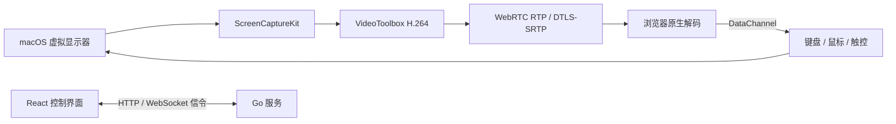

# RemoteMAC

[](#安装前提)
[](#从源码构建)
[](#工作原理)

**通过浏览器实时访问 macOS 桌面，并远程控制键盘、鼠标和触控。**

RemoteMAC 会在 Mac 上创建虚拟显示器，使用 ScreenCaptureKit 采集桌面、VideoToolbox 硬件编码 H.264，再通过 WebRTC 发送到浏览器。它适合可信局域网或已经互通的 VPN 网络。

> [!WARNING]
> RemoteMAC 目前仍是实验性项目。登录和 WebRTC 信令使用未加密的 HTTP，不要将服务直接暴露到公网。请先阅读[网络与安全](#网络与安全)。

## 目录

- [功能](#功能)
- [工作原理](#工作原理)
- [快速安装](#快速安装)
- [从源码构建](#从源码构建)
- [配置参考](#配置参考)
- [权限与安全](#权限与安全)
- [当前边界](#当前边界)
- [项目结构](#项目结构)
- [文档](#文档)

## 功能

| 能力 | 说明 |
| --- | --- |
| 桌面显示 | 创建 macOS 虚拟显示器，支持 HiDPI 模式和按浏览器视口调整尺寸 |
| 实时视频 | 使用 VideoToolbox 硬件编码 H.264，不重排帧 |
| WebRTC 传输 | 实时视频传输与 DTLS-SRTP 媒体加密 |
| 远程输入 | 键盘、鼠标、滚动、触控、文本输入和软键盘 |
| 画质控制 | 50% / 67% / 83% / 100% 画面比例；15 / 30 / 60 FPS；2 / 5 / 10 / 25 Mbps |
| 连接诊断 | 在浏览器本地显示接收码率、解码帧率、RTT 等 WebRTC 指标 |
| 单会话控制 | 同一时刻只允许一个远程控制会话 |

码率和帧率按用户选择应用，目前不会根据网络状况自动调节。网络承载不足时，较高的码率可能导致延迟或卡顿；静止桌面没有持续变化的画面，实际输出帧率也可能低于设置值。

## 工作原理



HTTP 和 WebSocket 负责登录、能力协商、SDP/ICE 信令、画质配置和虚拟显示器调整；桌面视频通过 WebRTC RTP 传输，输入事件通过 WebRTC DataChannel 返回 Mac。

## 快速安装

### 安装前提

- macOS，并已登录图形桌面会话
- `curl`、`unzip` 和 `shasum`
- 可用的 `sudo`，用于写入 `/usr/local/bin`
- 支持 WebRTC H.264 解码的现代浏览器

### 一键安装

安装器不需要项目源码、Go、Node.js、pnpm 或 Make。直接从 GitHub 获取并执行安装器：

```sh
curl -fsSL https://raw.githubusercontent.com/ynhuu/RemoteMAC/main/install.sh | sh -s -- install
```

如需先审阅脚本，再执行安装：

```sh
curl -fsSL https://raw.githubusercontent.com/ynhuu/RemoteMAC/main/install.sh -o /tmp/remotemac-install.sh
sh /tmp/remotemac-install.sh install
```

安装器会：

1. 从 `ynhuu/RemoteMAC` 最新 GitHub Release 下载当前 Mac 架构的 ZIP；
2. 校验 Release 提供的 `SHA256SUMS`；
3. 交互询问监听地址、端口和访问口令；
4. 将验证后的程序安装到 `/usr/local/bin/remotemac`；
5. 创建 macOS LaunchAgent，在用户登录后于后台启动服务。

默认监听地址是 `0.0.0.0:28080`。安装完成后，在浏览器打开：

```text
http://<Mac 的局域网 IP>:28080
```

本机健康检查不需要登录：

```sh
curl http://127.0.0.1:28080/healthz
```

卸载已安装的服务：

```sh
curl -fsSL https://raw.githubusercontent.com/ynhuu/RemoteMAC/main/install.sh | sh -s -- uninstall
```

安装器需要管理员权限写入 `/usr/local/bin`，并要求从交互式终端运行。安装结束后请从控制端连接一次，并按 macOS 提示授权屏幕录制和设备控制（辅助功能）；授权后重启服务：

```sh
launchctl kickstart -k "gui/$(id -u)/com.remotemac.server"
```

### 首次连接

1. 在控制端浏览器打开服务地址并输入访问口令，首次连接时按 macOS 提示允许 RemoteMAC 的屏幕录制和设备控制（辅助功能）权限。
2. 授权后执行上面的命令重启服务。
3. 连接后从控制面板调整分辨率比例、帧率、码率和鼠标模式。

## 从源码构建

如果需要参与开发或自行发布 Release，需要 Go 1.25+、启用 CGO 的 Xcode Command Line Tools、Node.js 与 pnpm。

安装依赖：

```sh
make deps
```

按目标架构构建：

```sh
# Apple Silicon
make build-arm64

# Intel Mac
make build-amd64
```

同时构建两个架构：

```sh
make build
```

手动启动服务时必须提供 `REMOTEMAC_TOKEN`：

```sh
export REMOTEMAC_TOKEN='设置一个仅供本地使用的口令'
./bin/remotemac-darwin-arm64 -host 0.0.0.0:8081
```

Intel Mac 使用 `./bin/remotemac-darwin-amd64`。源码启动默认监听 `0.0.0.0:8081`，可通过 `-host 地址:端口` 修改。

前端生产资源会被构建到 `internal/server/static` 并嵌入 Go 二进制。修改 `web/` 后，需要重新执行对应的构建命令。

构建时可以通过 `VERSION` 注入版本号。程序支持命令行查询版本，并会在控制面板中显示：

```sh
VERSION=v1.0.0 make build
./bin/remotemac-darwin-arm64 -version
```

生成用于发布的 macOS 双架构 ZIP 和校验和清单：

```sh
VERSION=v1.0.0 make release
```

产物位于 `bin/`：`remotemac-darwin-arm64.zip`、`remotemac-darwin-amd64.zip` 和 `SHA256SUMS`。安装器默认从 GitHub Release 下载这些资产。

## 配置参考

| 配置 | 必需 | 默认值 | 说明 |
| --- | --- | --- | --- |
| `REMOTEMAC_TOKEN` | 是 | — | HTTP 登录和远程控制使用的访问口令 |
| `-host` | 否 | `0.0.0.0:8081` | HTTP 服务监听地址；安装器会传入交互配置的地址 |
| `REMOTEMAC_ENABLE_TEST_NETWORK_SHAPER` | 否 | 未启用 | 设为 `1` 才注册测试用 UDP 出口限速接口 |

安装器生成的文件：

| 路径 | 用途 |
| --- | --- |
| `/usr/local/bin/remotemac` | 已安装的当前架构程序 |
| `~/.config/remotemac/password` | 访问口令，权限为 `600` |
| `~/.config/remotemac/settings` | 监听配置 |
| `~/Library/LaunchAgents/com.remotemac.server.plist` | 登录启动项 |
| `~/Library/Logs/RemoteMAC/` | 服务日志 |

## 权限与安全

### macOS 权限

- **屏幕录制**：连接桌面必须允许 RemoteMAC 捕获屏幕。
- **辅助功能**：注入键盘、鼠标等系统输入时可能需要允许辅助功能。
- **图形会话**：RemoteMAC 面向已登录的 macOS 图形桌面，不是无头服务器服务。

### 网络与安全

- 登录、HTTP API 和 WebSocket 信令使用 HTTP，当前没有 TLS；访问口令和信令内容可能被同一网络中的监听者读取。
- WebRTC 媒体使用 DTLS-SRTP 加密，但这不会保护 HTTP 登录页和信令。
- 推荐仅绑定可信局域网或受信任的 VPN；不要直接映射到公网。
- 项目不提供 TURN 中继，跨网络连接是否成功取决于两端的 UDP 路由和防火墙策略。

## 当前边界

- 仅支持 macOS 原生桌面采集；Intel 与 Apple Silicon 需要分别构建。
- 同时只支持一个远程控制会话。
- 不包含音频、剪贴板、文件传输和公网 TURN 中继。
- 虚拟显示器依赖 `CGVirtualDisplay`、SkyLight 等 macOS 接口，其中部分接口不是公开 API；macOS 升级后需要重新验收。
- `make check`、健康检查或曾经连接成功，都不能替代目标 iPhone、iPad、Android WebView 和实际网络环境的验证。

## 项目结构

```text
cmd/remotemac/       程序入口、参数和生命周期管理
internal/native/     macOS 虚拟显示、采集、编码和输入注入
internal/server/     HTTP 服务、认证、静态资源和 WebSocket 信令
internal/session/    WebRTC 会话、输入和 H.264 帧处理
internal/media/      RTP 分包、发送队列和 pacing
internal/netshape/   测试用网络限速器
web/                 React + Vite 控制界面
 docs/                技术文档和任务记录
```

## 检查与测试

```sh
make check
```

该命令会执行前端生产构建、安装脚本 Shell 语法检查、Go 测试和 `go vet`。双架构构建可以使用：

```sh
make -j2 build
```

## 文档

- [安装与卸载脚本](docs/安装脚本.md)：安装前提、交互配置、后台服务、文件路径和卸载行为
- [技术文档](docs/技术文档.md)：架构、画面管线、媒体传输、信令和已知边界
- [任务进度](docs/任务进度.md)：本地修改、构建和运行状态记录
